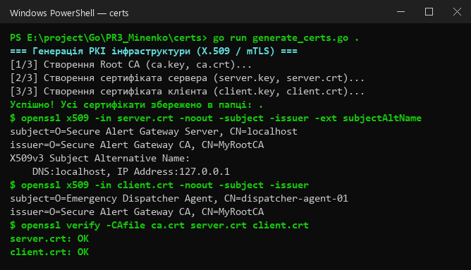
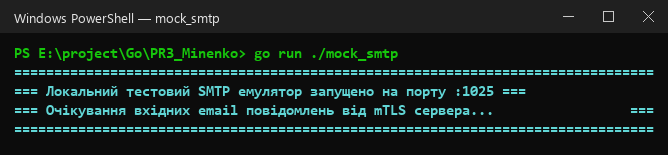
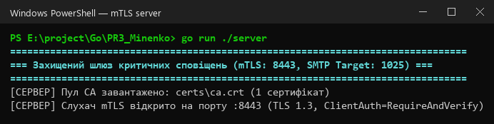
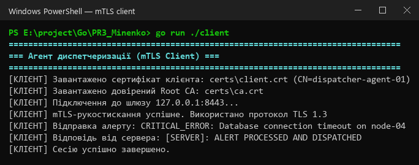
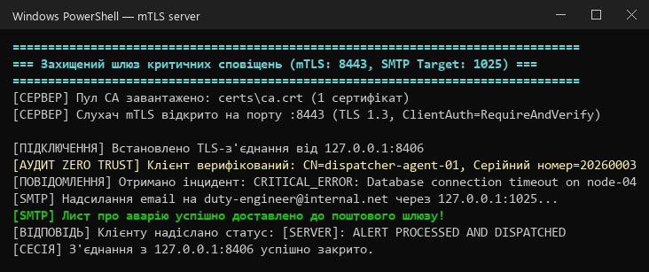
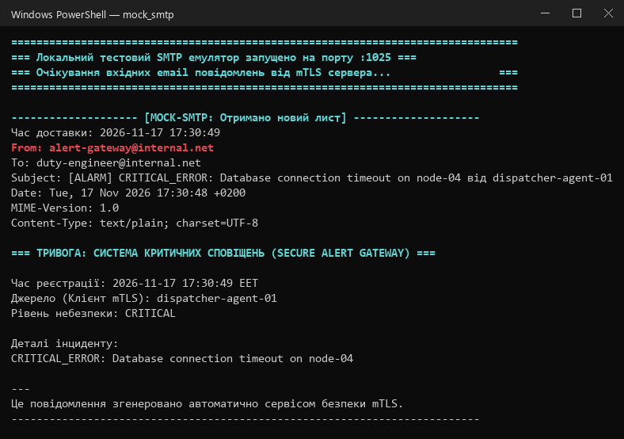
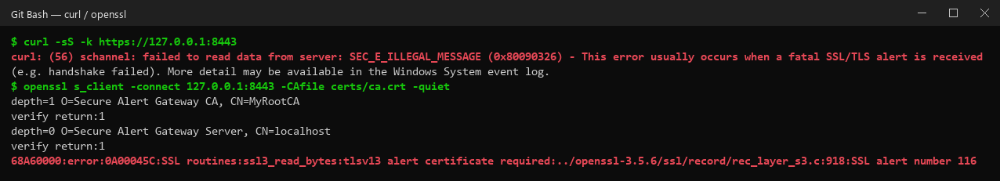
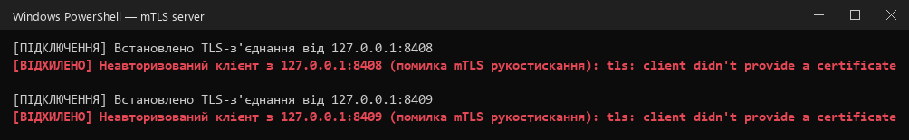
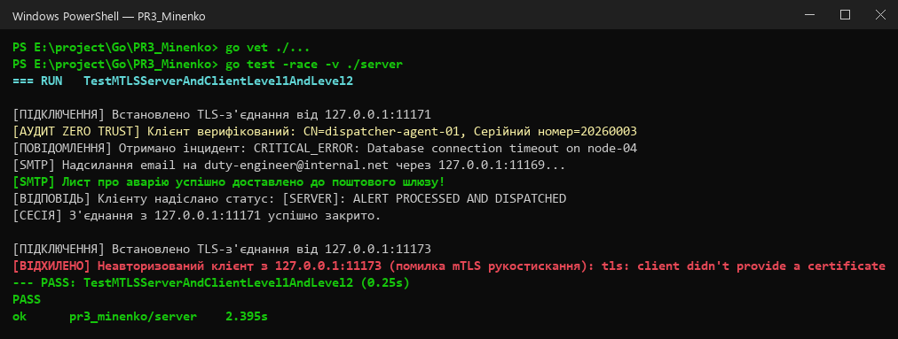

# Практична робота № 3
## Тема: Налаштування захищеного каналу mTLS та протокол SMTP
### (Реалізація: Рівень 1 та Рівень 2)

---

## Зміст
1. [Мета роботи](#мета-роботи)
2. [Опис реалізованої системи (Рівні 1 та 2)](#опис-реалізованої-системи-рівні-1-та-2)
3. [Структура проєкту](#структура-проєкту)
4. [Покрокова інструкція із запуску](#покрокова-інструкція-із-запуску)
   - [Крок 1. Генерація PKI інфраструктури (сертифікати mTLS)](#крок-1-генерація-pki-інфраструктури-сертифікати-mtls)
   - [Крок 2. Запуск SMTP сервера / емулятора](#крок-2-запуск-smtp-сервера--емулятора)
   - [Крок 3. Запуск захищеного mTLS сервера](#крок-3-запуск-захищеного-mtls-сервера)
   - [Крок 4. Запуск авторизованого mTLS клієнта](#крок-4-запуск-авторизованого-mtls-клієнта)
   - [Крок 5. Перевірка блокування неавторизованого доступу](#крок-5-перевірка-блокування-неавторизованого-доступу)
   - [Крок 6. Запуск автоматичних інтеграційних тестів](#крок-6-запуск-автоматичних-інтеграційних-тестів)
5. [Скріншоти роботи програми](#скріншоти-роботи-програми)
6. [Відповіді на контрольні питання](#відповіді-на-контрольні-питання)
7. [Висновок](#висновок)

---

## Мета роботи
- Опанувати принципи функціонування інфраструктури відкритих ключів (**PKI**) та генерації сертифікатів стандарту **X.509** (кореневий Root CA, серверні та клієнтські сертифікати).
- Набути практичних навичок конфігурації захищених TCP-з'єднань на базі пакета `crypto/tls` із забезпеченням двосторонньої автентифікації (**mTLS**) та верифікації сертифікатів за моделлю Zero Trust.
- Опанувати роботу з протоколом електронної пошти **SMTP** за допомогою стандартного пакета `net/smtp`.
- Навчитися формувати поштові повідомлення зі стандартними заголовками (`From`, `To`, `Subject`, `Date`) та протестувати доставку через емулятор поштового сервера.

---

## Опис реалізованої системи (Рівні 1 та 2)

Розроблено консольний **шлюз критичних сповіщень та аудиту (Secure Alert Gateway)**:

1. **Рівень 1 (Базовий: PKI та mTLS)**:
   - Створено локальний центр сертифікації **Root CA** (`ca.crt`, `ca.key`).
   - Створено та підписано сертифікат сервера (`server.crt`, `server.key`) з розширенням **SAN** (`DNS:localhost`, `IP:127.0.0.1`).
   - Створено та підписано сертифікат диспетчерського клієнта (`client.crt`, `client.key`) з атрибутом `CN=dispatcher-agent-01`.
   - Реалізовано TCP-сервер (`server/main.go`) на базі `crypto/tls` (порт `:8443`, версія **TLS 1.3**), що вимагає та верифікує клієнтський сертифікат (`ClientAuth: tls.RequireAndVerifyClientCert`).
   - Реалізовано mTLS-клієнта (`client/main.go`), що надає свій сертифікат і перевіряє сертифікат сервера через спільний Root CA.
   - Забезпечено блокування будь-яких неавторизованих клієнтів (без дійсного сертифіката Root CA).

2. **Рівень 2 (Ключовий: SMTP Email Service)**:
   - Створено окремий поштовий модуль `email/mailer.go` на базі `net/smtp`.
   - Сервер після успішного mTLS-рукостискання автоматично вилучає ідентифікатор клієнта (`CN`), формує поштове сповіщення з датою, часом і деталями збою та надсилає його через SMTP на адресу чергового інженера `duty-engineer@internal.net` (порт `:1025`).
   - Створено автономний тестовий SMTP-емулятор (`mock_smtp/main.go`), який дозволяє тестувати систему локально без сторонніх залежностей, а також підтримується робота з емулятором **Mailpit** / **MailHog** або Docker.

---

## Структура проєкту

```text
PR3_Minenko/
├── certs/                      # PKI сертифікати та скрипти генерації
│   ├── ca.crt                  # Кореневий сертифікат Root CA
│   ├── ca.key                  # Закритий ключ Root CA
│   ├── server.crt              # Сертифікат сервера (SAN: localhost, 127.0.0.1)
│   ├── server.key              # Закритий ключ сервера
│   ├── client.crt              # Клієнтський сертифікат (CN=dispatcher-agent-01)
│   ├── client.key              # Закритий ключ клієнта
│   ├── generate_certs.go       # Генератор X.509 сертифікатів на Go
│   ├── generate_certs.ps1      # PowerShell-скрипт генерації
│   └── generate_certs.sh       # Bash-скрипт генерації
├── email/                      # Модуль відправки пошти через SMTP
│   └── mailer.go               # Реалізація Mailer (net/smtp, MIME-заголовки)
├── server/                     # Захищений mTLS сервер
│   ├── main.go                 # Основний сервер (порт :8443, інтеграція з SMTP)
│   └── server_test.go          # Інтеграційні тести (Рівень 1 + Рівень 2)
├── client/                     # Авторизований mTLS клієнт
│   └── main.go                 # Клієнт для передачі алерту (порт :8443)
├── mock_smtp/                  # Локальний тестовий SMTP сервер
│   └── main.go                 # SMTP емулятор (порт :1025)
├── png/                        # Скріншоти для звіту
├── go.mod                      # Go модуль (pr3_minenko)
└── README.md                   # Документація та звіт
```

---

## Покрокова інструкція із запуску

### Крок 1. Генерація PKI інфраструктури (сертифікати mTLS)

Сертифікати вже присутні в папці `certs/`. Якщо ви хочете згенерувати їх наново:

**У PowerShell (Windows):**
```powershell
cd certs
go run generate_certs.go .
cd ..
```
*або через PowerShell-скрипт:*
```powershell
.\certs\generate_certs.ps1
```

**У Linux/macOS:**
```bash
./certs/generate_certs.sh
```

---

### Крок 2. Запуск SMTP сервера / емулятора

Для прийому поштових сповіщень (порт `:1025`) відкрийте **Термінал № 1** та запустіть один із варіантів:

#### Варіант А (Вбудований Go SMTP емулятор — найпростіший, без Docker):
```powershell
go run ./mock_smtp/main.go
```
*Він слухатиме на `127.0.0.1:1025` та виводитиме всі отримані листи у консоль.*

#### Варіант Б (Через Mailpit у Docker):
```bash
docker run -d -p 1025:1025 -p 8025:8025 axllent/mailpit
```
*Вебінтерфейс Mailpit буде доступний за адресою: http://localhost:8025*

---

### Крок 3. Запуск захищеного mTLS сервера

У **Терміналі № 2** запустіть сервер:
```powershell
go run ./server/main.go
```
*Сервер відкриє TLS 1.3 слухач на порту `:8443` із обов'язковою верифікацією клієнтських сертифікатів (`RequireAndVerifyClientCert`).*

---

### Крок 4. Запуск авторизованого mTLS клієнта

У **Терміналі № 3** надішліть сповіщення про критичний інцидент:
```powershell
go run ./client/main.go
```
*Клієнт встановить захищене mTLS-з'єднання, передасть повідомлення:*
`CRITICAL_ERROR: Database connection timeout on node-04`
*та отримає відповідь від сервера:*
`[SERVER]: ALERT PROCESSED AND DISPATCHED`

**У цей момент:**
- Сервер зафіксує CN клієнта (`CN=dispatcher-agent-01`);
- Сервер автоматично надішле email через SMTP на адресу `duty-engineer@internal.net`;
- У Терміналі № 1 (SMTP) з'явиться доставлений лист.

---

### Крок 5. Перевірка блокування неавторизованого доступу

У **Терміналі № 3** спробуйте підключитися до сервера без клієнтського сертифіката:

**Через curl.exe:**
```powershell
curl.exe -k https://localhost:8443
```

**Очікуваний результат:**
- `curl` отримає помилку рукостискання (у Windows: `schannel: ... SEC_E_ILLEGAL_MESSAGE`, у Linux: `alert certificate required`);
- `openssl s_client -connect 127.0.0.1:8443 -CAfile certs/ca.crt -quiet` перевірить сертифікат сервера, але отримає `tlsv13 alert certificate required`;
- У консолі сервера (Термінал № 2) з'явиться повідомлення про відхилення:
  ```text
  [ВІДХИЛЕНО] Неавторизований клієнт з 127.0.0.1:... (помилка mTLS рукостискання): tls: client didn't provide a certificate
  ```

---

### Крок 6. Запуск автоматичних інтеграційних тестів

Для швидкої автоматичної перевірки обох рівнів (mTLS з'єднання + передача алерту + доставка SMTP + відхилення неавторизованого запиту):
```powershell
go vet ./...
$env:CGO_ENABLED=1; go test -race -v ./server
```
Для `-race` потрібен C-компілятор (у Windows: `gcc` з MSYS2, каталог `C:\msys64\ucrt64\bin` у `PATH`). Без нього тест запускається командою `go test -v ./server`.
*Тест перевіряє весь ланцюг: mTLS-з'єднання, передачу алерту, доставку листа через SMTP та відхилення клієнта без сертифіката.*

---

## Скріншоти роботи програми

| № | Файл | Що показано |
|---|------|-------------|
| 1 | `1_generate_certs.png` | Генерація Root CA, сертифікатів сервера та клієнта; перевірка SAN, CN та ланцюжка довіри через `openssl` |
| 2 | `2_smtp_emulator_start.png` | Запуск SMTP-емулятора на порту `:1025` |
| 3 | `3_server_start.png` | Запуск mTLS-сервера: пул CA, слухач `:8443`, TLS 1.3, `RequireAndVerify` |
| 4 | `4_client_sent.png` | mTLS-клієнт: рукостискання TLS 1.3, відправка алерту, відповідь `ALERT PROCESSED AND DISPATCHED` |
| 5 | `5_server_processed_email.png` | Журнал сервера: верифікація `CN=dispatcher-agent-01`, отримання інциденту, доставка листа |
| 6 | `6_email_received_in_smtp.png` | Лист у SMTP-емуляторі: заголовки `From`, `To`, `Subject`, `Date` та текст аварії |
| 7 | `7_unauthorized_client.png` | Підключення без сертифіката через `curl` та `openssl s_client`: TLS alert `certificate required` |
| 8 | `8_unauthorized_server.png` | Журнал сервера: `[ВІДХИЛЕНО] ... tls: client didn't provide a certificate` |
| 9 | `9_go_test_passed.png` | `go vet` та `go test -race -v ./server` без помилок |

#### 1. Генерація інфраструктури відкритих ключів PKI


#### 2. Запуск локального поштового емулятора SMTP (:1025)


#### 3. Запуск захищеного mTLS сервера (:8443)


#### 4. Відправка критичного алерту авторизованим mTLS клієнтом


#### 5. Журнал сервера: верифікація сертифіката клієнта та виклик SMTP


#### 6. Отриманий email лист черговому інженеру в поштовому сервісі


#### 7. Спроба підключення без клієнтського сертифіката


#### 8. Відхилення неавторизованого клієнта на сервері


#### 9. Автоматичні тести


---

## Відповіді на контрольні питання

### 1. Чим відрізняється стандартний односторонній протокол TLS від взаємного TLS (mTLS) під час рукостискання?
У стандартному односторонньому TLS сервер передає свій сертифікат клієнту, а клієнт перевіряє його за допомогою списку довірених Root CA (клієнт залишається анонімним на транспортному рівні).  
У **mTLS** під час фази рукостискання сервер надсилає запит `CertificateRequest`. Клієнт зобов'язаний надати свій персональний цифровий сертифікат (`Certificate`) та підтвердити володіння закритим ключем за допомогою підпису `CertificateVerify`. Сервер звіряє цей сертифікат зі своїм списком довірених центрів сертифікації (`ClientCAs`). Тільки після успішної взаємної перевірки встановлюється зашифрований канал.

### 2. Яку роль відіграє параметр `tls.RequireAndVerifyClientCert` у структурі `tls.Config` сервера Go?
Цей параметр встановлює найсуворішу політику перевірки клієнта:
- Сервер **обов'язково вимагає** наявність клієнтського сертифіката під час TLS-рукостискання;
- Сервер **перевіряє дійсність підпису** клієнтського сертифіката, термін його дії та ланцюжок довіри до вказаного пулу `ClientCAs`;
- Якщо клієнт не надав сертифікат або надав сертифікат від стороннього невідомого CA, з'єднання негайно скидається з помилкою рукостискання (TLS alert `bad certificate` або `certificate required`).

### 3. Чому для внутрішньої взаємодії мікросервісів у моделі Zero Trust часто використовують саме mTLS замість традиційної передачі паролів чи API-ключів у заголовках?
- **Криптографічна надійність на транспортному рівні:** Автентифікація відбувається до передачі будь-яких прикладних даних. Якщо клієнт не пройшов перевірку, він навіть не зможе надіслати HTTP/TCP пакет з даними.
- **Неможливість викрадення/перехоплення статичного пароля:** Закритий ключ клієнта ніколи не передається мережею. Клієнт лише створює цифровий підпис одноразових даних рукостискання.
- **Автоматичне наскрізне шифрування:** mTLS гарантує конфіденційність, цілісність даних та захист від атак Man-in-the-Middle (MITM).

### 4. Яке призначення поля SAN (Subject Alternative Name) у сертифікатах X.509 і чому сучасні браузери та Go ігнорують поле Common Name для перевірки доменів?
Поле **SAN** дозволяє прив'язати сертифікат до одного або кількох доменних імен (`DNS:localhost`, `DNS:example.com`) та IP-адрес (`IP:127.0.0.1`).  
Поле `Common Name (CN)` було визнано застарілим у RFC 2818 та RFC 6125, оскільки воно підтримує лише одне значення, має неоднозначну семантику та вразливе до підміни. Go починаючи з версії 1.15 за замовчуванням вимагає наявність поля SAN та повністю ігнорує CN під час перевірки імені хоста.

### 5. Чим відрізняється робота поштового протоколу через механізм STARTTLS (порт 587) від SMTP over SSL/TLS (порт 465)?
- **SMTP over SSL/TLS (Implicit TLS, порт 465):** З'єднання відразу починається з криптографічного TLS-рукостискання. Будь-які команди SMTP передаються виключно всередині вже встановленого шифрованого тунелю.
- **STARTTLS (Explicit TLS, порт 587 / 25):** Клієнт встановлює звичайне відкрите TCP-з'єднання, вітається з сервером (`EHLO`), а потім надсилає явну текстову команду `STARTTLS`. Після згоди сервера відкрите з'єднання модернізується (upgrade) до захищеного TLS.

### 6. Як влаштований багатокомпонентний лист формату MIME (Multipart) та яку функцію виконує параметр `boundary`?
Лист MIME містить заголовок `Content-Type: multipart/mixed; boundary="====BOUNDARY_STRING===="`.  
Параметр `boundary` визначає унікальний текстовий рядок-маркер, який поштовий клієнт використовує для розбиття єдиного потоку даних на окремі секції:
- Кожна частина починається з `--` + рядок boundary;
- Всередині кожної частини є власні MIME-заголовки (наприклад, `Content-Type: text/plain` або `Content-Disposition: attachment`);
- Після заголовків частини слідує порожній рядок і тіло (текст, HTML або Base64 файлу);
- Завершується лист рядком `--` + boundary + `--`.

### 7. Чому бінарні файли вкладень у поштових листах необхідно кодувати за допомогою алгоритму Base64?
Протокол SMTP історично розроблявся для передачі лише 7-бітного ASCII тексту (`0x00`-`0x7F`). Бінарні файли (архіви, зображення, дампи логів) містять байтові послідовності `0x80`-`0xFF`, а також керівні символи (зокрема `\r\n.\r\n`), які поштовий сервер може сприйняти як завершення повідомлення або спотворити при трансляції.  
Алгоритм **Base64** перетворює довільні 3 байти бінарних даних у 4 безпечні друковані символи ASCII (A-Z, a-z, 0-9, `+`, `/`), гарантуючи безпечну доставку через будь-який поштовий шлюз.

### 8. Які переваги дає використання локальних SMTP-емуляторів (Mailpit, MailHog) під час розробки та автоматизованого тестування ПЗ?
- **Безпека:** Відсутній ризик випадково надіслати тестові повідомлення чи алерти реальним адресатам.
- **Швидкість розробки:** Не потрібні реальні облікові записи пошти, складні паролі додатків, SPF/DKIM налаштування або доступ до Інтернету.
- **Зручна інспекція:** Надають вебінтерфейс для миттєвого перегляду заголовків, рендерингу HTML та завантаження вкладень.
- **Ізоляція:** Листи зберігаються тимчасово у пам'яті емулятора і не засмічують робочі поштові скриньки.

---

## Висновок
Під час виконання практичної роботи № 3 (Рівні 1 та 2):
1. Побудовано повноцінну інфраструктуру відкритих ключів PKI: згенеровано Root CA, сертифікат сервера із SAN розширеннями та клієнтський сертифікат диспетчера.
2. Реалізовано захищений TCP-сервер на базі `crypto/tls` з обов'язковою взаємною автентифікацією (mTLS) та підтримкою TLS 1.3.
3. Протестовано механізм блокування неавторизованих запитів без сертифіката.
4. Розроблено поштовий модуль `email/mailer.go` на базі `net/smtp`, який автоматично відправляє деталі аварії черговому інженеру на поштовий шлюз.
5. Написано автономний SMTP-емулятор та набір інтеграційних тестів на Go, що підтверджують безпомилкову роботу компонентів системи.

